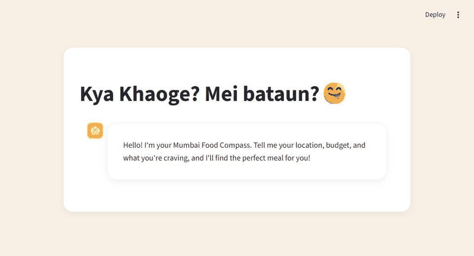

<p align="center">
  <a href="https://github.com/Sairaj-24/Kya-Khaoge/tree/main">
    
  </a>
</p>

<h1 align="center">Kya Khaoge? Mei bataun? 😋</h1>

<p align="center">
  A small Mumbai food compass. Tell it where you are, what you’ll spend,
  and what you’re craving. It answers like a friend who knows the stalls.
</p>

<p align="center">
  <a href="https://github.com/Sairaj-24/Kya-Khaoge/tree/main"><strong>Open the main branch</strong></a>
  ·
  <a href="https://github.com/Sairaj-24/Kya-Khaoge">Sairaj-24/Kya-Khaoge</a>
</p>

This page describes the app on [`main`](https://github.com/Sairaj-24/Kya-Khaoge/tree/main). The demo below was recorded by running that branch locally.

## Demo

Asked on `main`: *I’m near Sion, have ₹150 and want pav bhaji.*

<p align="center">
  
</p>

<p align="center">
  <a href="docs/demo-main.mp4"><strong>Watch the demo video</strong></a>
</p>

The reply names real stalls from the sheet — price, landmark, a one-line reason, and a Google Maps link.

## What it does

You type one sentence in the chat. The app does the rest.

- Pulls **location**, **budget**, and **craving** out of that sentence.
- Reads a food list from a public Google Sheet.
- Answers in short Hinglish, as *Food Dost*, with up to three stalls.
- Uses the time in Mumbai so a morning ask and a late-night ask don’t get the same picks.

Location is required. If you skip a budget, it assumes **₹100**. If you skip a craving, it looks for something popular.

## Run `main` locally

```bash
git clone https://github.com/Sairaj-24/Kya-Khaoge.git
cd Kya-Khaoge
git checkout main
python -m venv .venv
```

Windows:

```powershell
.\.venv\Scripts\activate
pip install -r requirements.txt
```

macOS or Linux:

```bash
source .venv/bin/activate
pip install -r requirements.txt
```

Create `.streamlit/secrets.toml` (this file stays on your machine and is not on `main`):

```toml
GEMINI_API_KEY = "your-gemini-api-key"
SHEET_URL = "https://docs.google.com/spreadsheets/d/your-sheet-id/export?format=csv"
```

The sheet needs these columns: `stall_name`, `dish_name`, `price_inr`, `location_area`, `landmark`, `gmaps_link`. Tags and notes are optional.

```bash
streamlit run app.py
```

Then open the local URL Streamlit prints, usually [http://localhost:8501](http://localhost:8501).

Try something the sheet actually covers, for example: *I’m near Sion, have ₹150 and want pav bhaji.*

## How a reply is made

1. Gemini reads your message and returns location, budget, and craving as JSON.
2. `app.py` loads the sheet into a table.
3. Gemini picks up to three rows and writes the reply: dish, stall, price, address, why it’s mast, and the map link.

## What’s on `main`

| File | What it is |
| --- | --- |
| [`app.py`](https://github.com/Sairaj-24/Kya-Khaoge/blob/main/app.py) | The Streamlit chat |
| [`requirements.txt`](https://github.com/Sairaj-24/Kya-Khaoge/blob/main/requirements.txt) | Python packages |
| [`.streamlit/config.toml`](https://github.com/Sairaj-24/Kya-Khaoge/blob/main/.streamlit/config.toml) | Beige and coral theme |
| [`.devcontainer/devcontainer.json`](https://github.com/Sairaj-24/Kya-Khaoge/blob/main/.devcontainer/devcontainer.json) | Optional GitHub Codespaces setup |

Secrets are listed in `.gitignore`, so the API key never lands on `main`.
